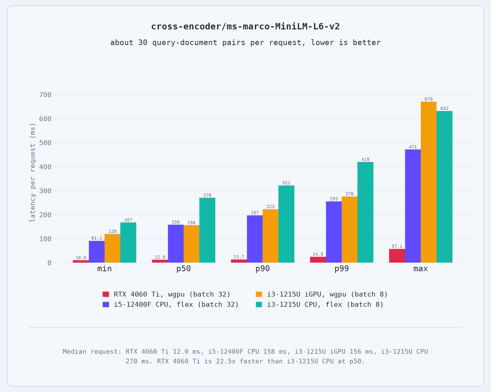
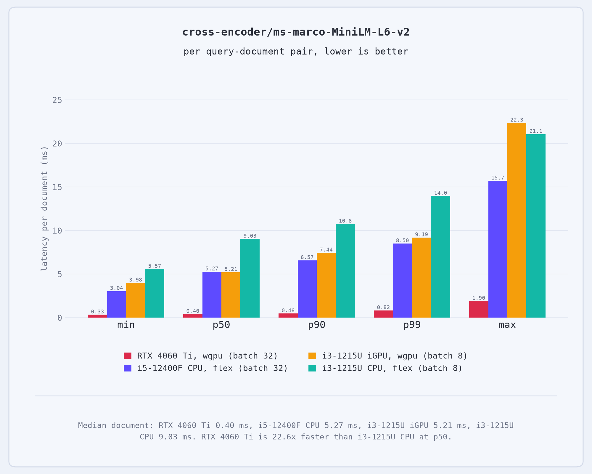

# Oxidizing reranking

**BERT cross-encoder inference in pure Rust. Supports both CPU and GPU.**

Runs on cpu via burn's flex or on GPU via the wgpu backend.

| Latency per request | Latency per document |
|--|--|
|  |   |

## Setup

The model expects weights in a `weights/` directory at the project root. Download from here: [cross-encoder/ms-marco-MiniLM-L6-v2](https://huggingface.co/cross-encoder/ms-marco-MiniLM-L6-v2/tree/main)
<br>
You need the following files from your desired cross-encoder model:

* `weights/config.json`
* `weights/tokenizer.json`
* `weights/model.safetensors`

## Usage

Run the standard binary to perform a sanity check. It evaluates a hardcoded query against two sample documents to verify output logits.

```
cargo run --release
```

## Benchmarking

The project includes a benchmarking suite (`bench.rs`) to evaluate throughput, per-request latency, and per-document latency. It implements length-sorting within batches to minimize padding waste.

```
cargo run --release --bin bench -- --batch 32 --device cpu
```

### Benchmark Arguments

* `--batch`: Batch size for length-sorted inference (default: 16).

* `--device`: Device to use for inference (default: gpu). Use `cpu` or `gpu`.

* `--warmup`: Number of warmup entries to process before timing (default: 20).

* `--limit`: Maximum number of dataset entries to evaluate.

---